<div align="center">


&nbsp;&nbsp;&nbsp;&nbsp;&nbsp;&nbsp;


<br/>

### Universidade Tecnológica Federal do Paraná - UTFPR
**Campus Guarapuava · Tecnologia em Sistemas para Internet (TSI)**
*Análise e Projeto Orientado a Objetos · Exame de suficiência*

# 🚗 Sistema Integrado de Gestão Veicular

### Estudo de caso resolvido em UML: casos de uso, especificação, atividades, classes e sequência, todos ligados entre si e verificados automaticamente


**Aluno:** Ricardo Martins de Oliveira · [GitHub](https://github.com/Roliveira96) · [LinkedIn](https://www.linkedin.com/in/ricardodeoliveira96/) · [rmo.dev.br](https://rmo.dev.br)
**Professor:** Denis Lucas Silva

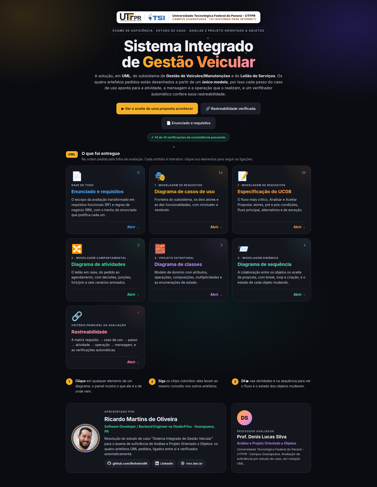

</div>

---

## 📑 Sumário

- [O que foi pedido](#-o-que-foi-pedido)
- [Os artefatos entregues](#-os-artefatos-entregues)
- [O sistema em imagens](#-o-sistema-em-imagens)
- [Principais decisões de modelagem](#-principais-decisões-de-modelagem)
- [Rastreabilidade verificada](#-rastreabilidade-verificada)
- [Como rodar](#-como-rodar)
- [Estrutura do projeto](#-estrutura-do-projeto)

---

## 🎯 O que foi pedido

O enunciado completo está em [`docs/enunciado.md`](docs/enunciado.md). O escopo da avaliação é o subsistema de **Gestão de Veículos/Manutenções** e o **Leilão de Serviços** (solicitação de orçamento → propostas das empresas → aceite → agendamento). As ofertas preditivas (pilar 3) ficam fora, como determina a folha de avaliação.

| Item pedido | Onde está |
|---|---|
| 1. Diagrama de casos de uso | Tela **Casos de uso** · [imagem](docs/diagrams/1-casos-de-uso.png) |
| 1. Especificação textual do fluxo mais crítico | Tela **Especificação do UC08** (Analisar e Aceitar Proposta) |
| 2. Diagrama de atividades do leilão | Tela **Atividades** · [imagem](docs/diagrams/2-atividades.png) |
| 3. Diagrama de classes de domínio | Tela **Classes** · [imagem](docs/diagrams/3-classes.png) |
| 4. Diagrama de sequência | Tela **Sequência** · [imagem](docs/diagrams/4-sequencia.png) |
| Consistência e rastreabilidade | Tela **Rastreabilidade**, com matriz e 14 verificações automáticas |

---

## 🧩 Os artefatos entregues

Cada diagrama abaixo é a imagem exportada do sistema em tamanho real. Clique para ampliar.

### 1 · Diagrama de casos de uso

Dois atores (Proprietário e Empresa Parceira) e dez casos de uso dentro da fronteira do subsistema. `«include»`: abrir uma solicitação sempre identifica as empresas compatíveis (UC04 → UC05), e aceitar uma proposta sempre gera o agendamento (UC08 → UC09). `«extend»`: cancelar a solicitação é opcional dentro da análise das propostas (UC10 → UC08).

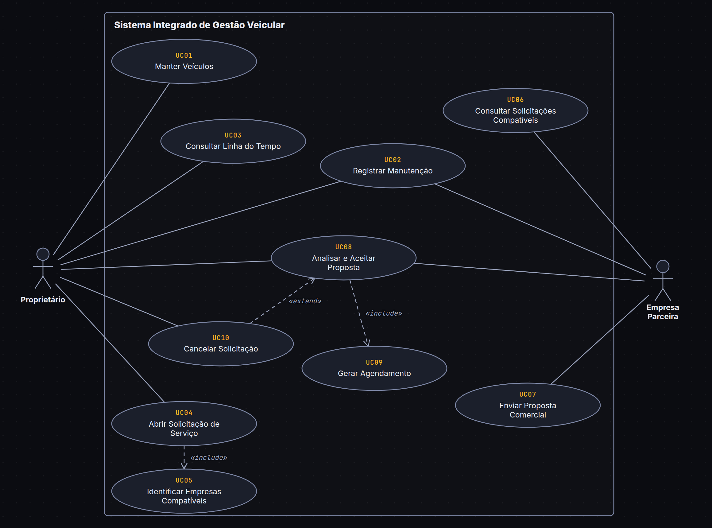

### 1 · Especificação do UC08: Analisar e Aceitar Proposta

O fluxo mais crítico, porque é onde o leilão muda de estado de forma irreversível: uma proposta é aceita, as demais são recusadas, a solicitação é concluída e nasce o agendamento. A especificação traz:
- atores, pré-condições e pós-condições de sucesso e de falha;
- 11 passos no fluxo principal;
- **FA01** Cancelar, **FA02** Aguardar novas propostas e **FA03** Consultar empresa;
- **FE01** Proposta expirada e **FE02** Leilão já encerrado.

Cada passo aponta para a ação do diagrama de atividades, a mensagem do diagrama de sequência e a operação da classe que o realizam.

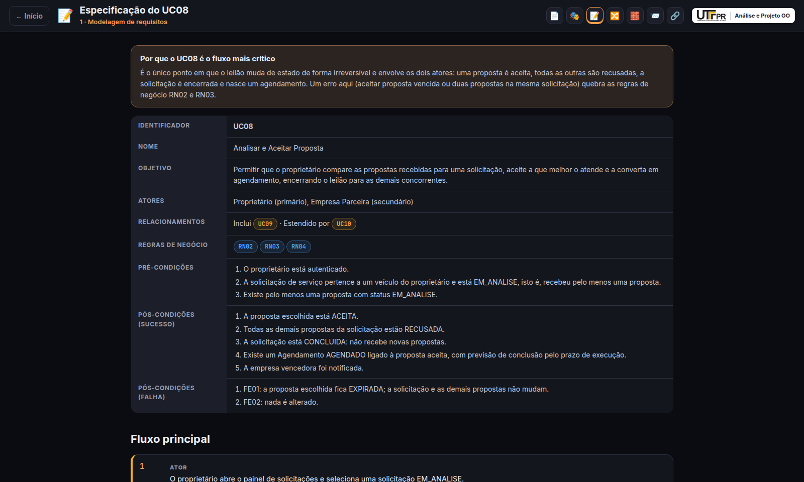

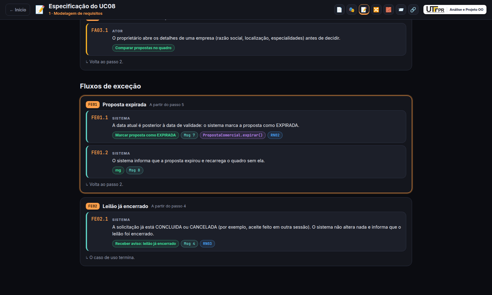

### 2 · Diagrama de atividades

O leilão em três raias (Proprietário, Sistema, Empresa Parceira), com:
- decisões com guardas;
- nó de junção (merge) para voltar ao quadro comparativo;
- região `«parallel»` para cada empresa notificada;
- final de fluxo (⊗) para a empresa que não participa;
- fork/join no fim, para o aviso à empresa e o comprovante.

Cada fluxo alternativo e de exceção do UC08 vira um ramo do diagrama.

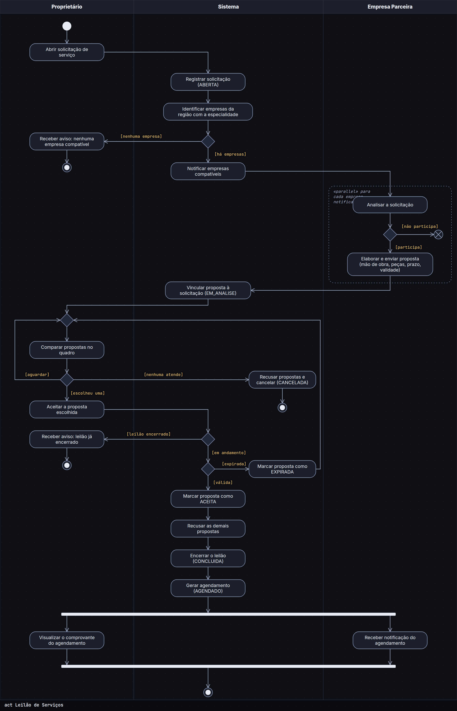

### 3 · Diagrama de classes

O modelo de domínio:
- composições: os registros pertencem ao veículo, os itens ao registro e as propostas à solicitação;
- multiplicidades que sustentam as regras: `0..1` agendamento por proposta e `1..*` itens por registro;
- o atributo derivado `/valorPago`;
- `Localizacao` como `«dataType»` e `ControladorLeilao` como `«control»`;
- sete enumerações de estado e de tipo.

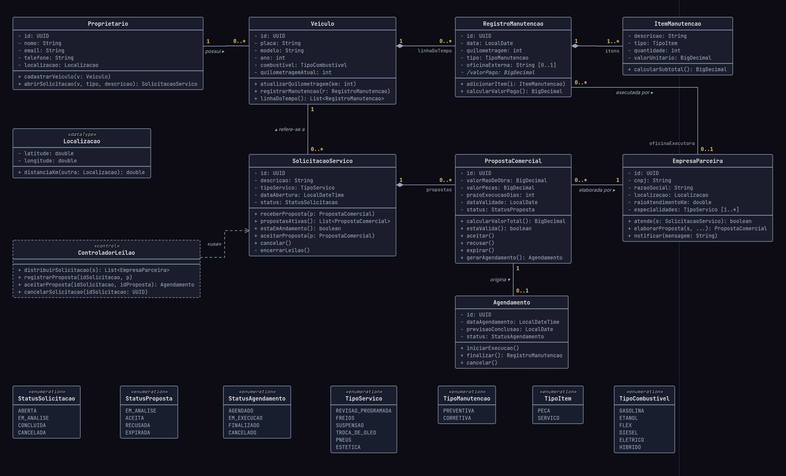

### 4 · Diagrama de sequência

O aceite de uma proposta, com `break` para os dois fluxos de exceção, `loop` para recusar as demais propostas, automensagem `encerrarLeilao()` e mensagem `«create»` do agendamento.

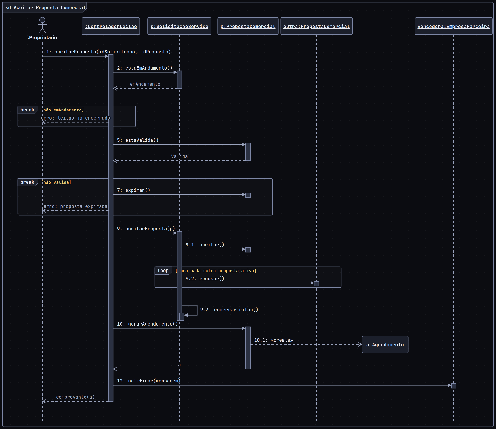

---

## 📸 O sistema em imagens

**1. Casos de uso interativos.** Ao clicar em um caso de uso, as associações e relações dele se acendem. O painel mostra os atores, os requisitos que o originam e as ações do diagrama de atividades que o realizam.

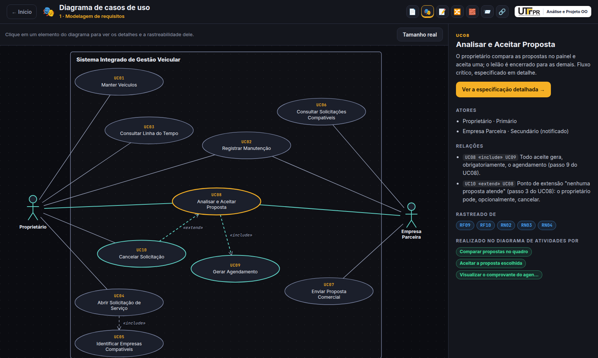

**2. Diagrama de atividades animado.** São seis cenários: sucesso, proposta expirada, cancelamento, leilão encerrado, nenhuma empresa e empresa que não participa. Um ponto percorre o fluxo pelas raias, e cada ação mostra as operações e o passo do UC08 que ela realiza.

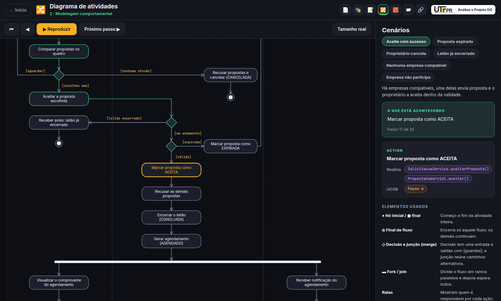

**3. Diagrama de classes navegável.** Ao clicar em uma operação, o painel mostra a assinatura completa e onde ela aparece: requisito, passo do UC08, ação do diagrama de atividades e mensagem do diagrama de sequência.

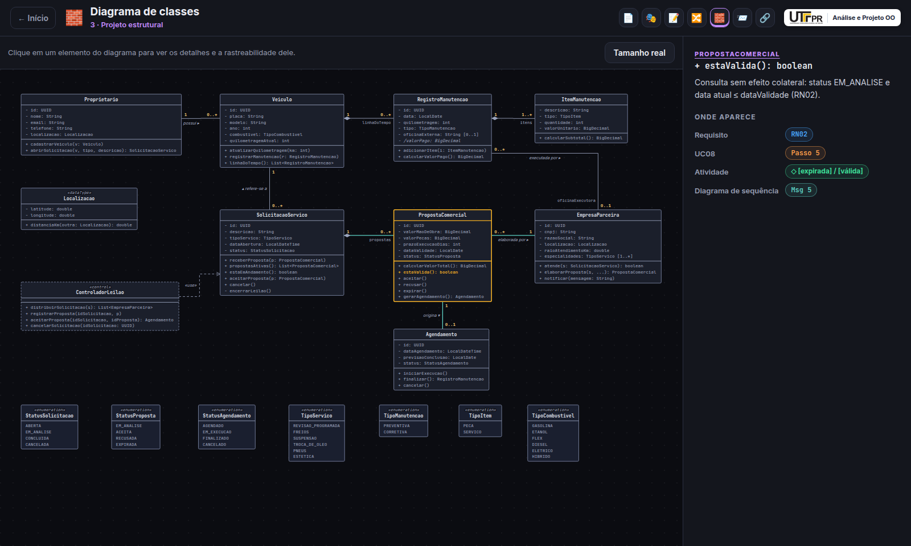

**4. Diagrama de sequência passo a passo.** A mensagem atual se acende, e o painel mostra o passo do caso de uso que ela realiza e o **estado de cada objeto** mudando (EM_ANALISE → ACEITA, RECUSADA, CONCLUIDA, AGENDADO).

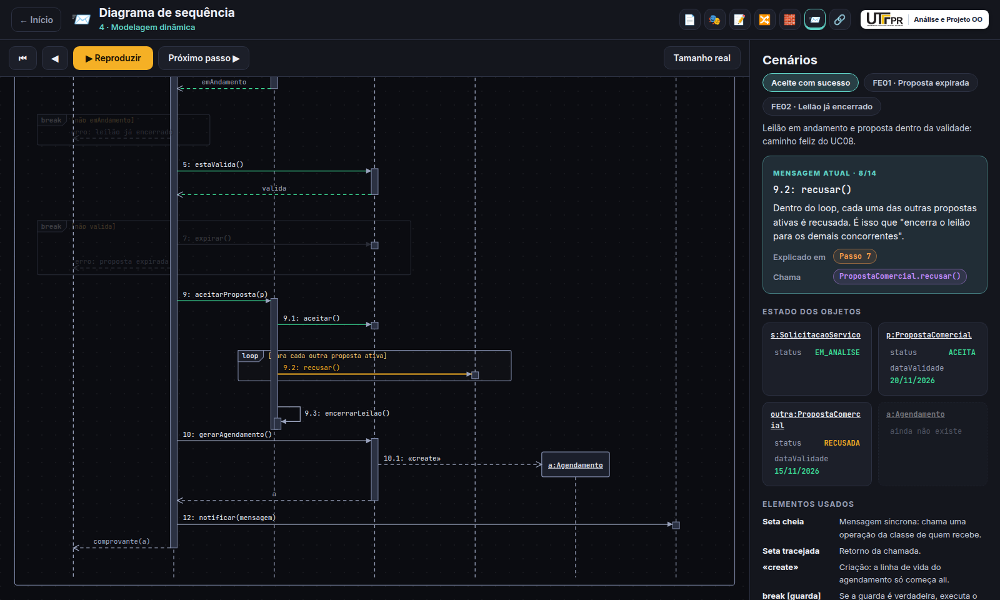

**5. Os fluxos de exceção também são executados.** No FE01, só as mensagens do cenário ficam acesas e a proposta passa a EXPIRADA.

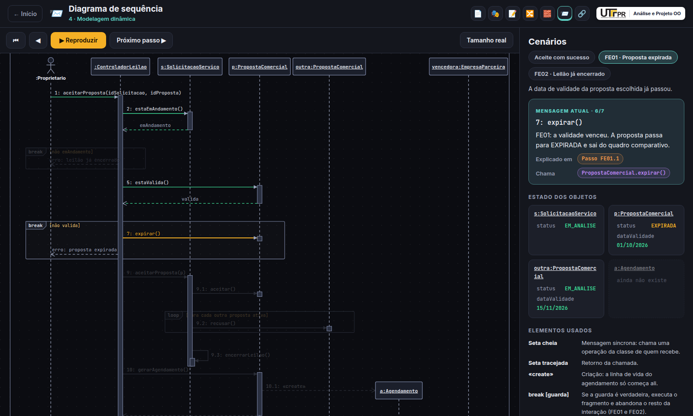

**6. Requisitos com origem no enunciado.** São 11 requisitos funcionais e 7 regras de negócio, cada um com o trecho do enunciado que o justifica e os casos de uso e classes que o atendem.

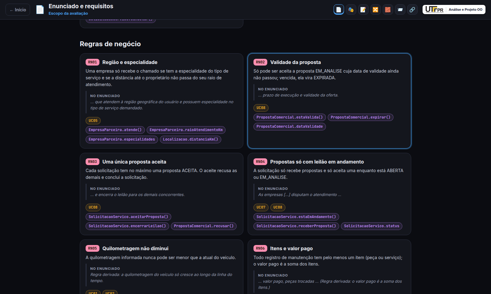

**7. Rastreabilidade: verificações automáticas e matriz.**

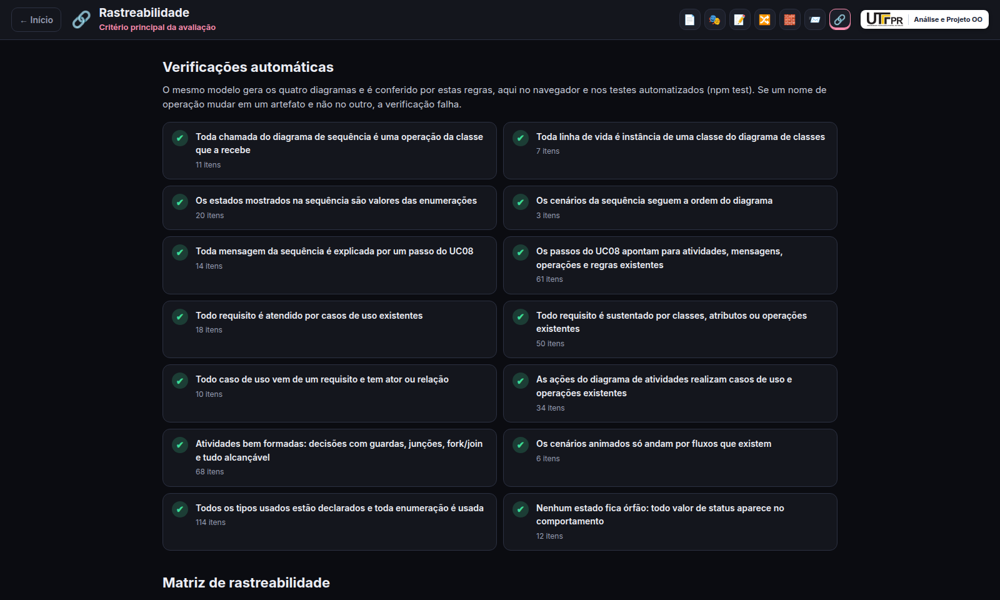

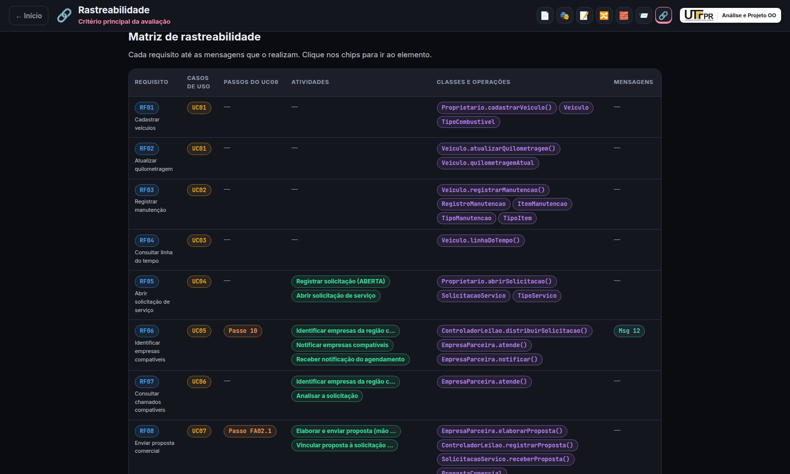

---

## 🧠 Principais decisões de modelagem

- **Especialista na Informação (GRASP).** `SolicitacaoServico` conhece as suas propostas. Por isso é ela quem aceita uma e recusa as demais (`aceitarProposta`), e só ela muda o próprio status, pela operação privada `encerrarLeilao()`.
- **Criador (GRASP).** `PropostaComercial` cria o `Agendamento`, porque tem os dados que o inicializam: a empresa, o prazo e o valor.
- **Controlador (GRASP).** `ControladorLeilao` recebe os eventos da interface e só delega; não guarda regra de negócio.
- **Consulta sem efeito colateral.** `estaValida()` só responde; quem marca a proposta como EXPIRADA é `expirar()`, no FE01.
- **Uma única proposta aceita (RN03).** Garantida por `estaEmAndamento()` + `aceitarProposta()` na solicitação. O FE02 cobre o aceite simultâneo feito em outra sessão.
- **Nenhum estado órfão.** Todo valor de `StatusSolicitacao`, `StatusProposta` e `StatusAgendamento` aparece em alguma pré/pós-condição, passo, ação ou mensagem. `EM_ANALISE` na solicitação indica que ela já recebeu proposta.
- **Os dois subsistemas se ligam.** `Agendamento.finalizar()` devolve o `RegistroManutencao` que entra na linha do tempo. Manutenções feitas fora da plataforma usam `oficinaExterna`.

O processo de revisão está documentado em [`docs/revisao-rascunho.md`](docs/revisao-rascunho.md). Lá estão as inconsistências encontradas nos rascunhos iniciais e como cada uma foi resolvida.

---

## 🔗 Rastreabilidade verificada

Os quatro diagramas **não foram desenhados à mão um a um**. Todos são gerados a partir de um único modelo (`src/content/model`). Sobre esse modelo, um verificador de consistência (`src/model/ConsistencyChecker.ts`) aplica as regras que um revisor usaria, por exemplo:

- toda chamada do diagrama de sequência é uma operação da classe que a recebe;
- todo estado mostrado é um valor da enumeração;
- toda mensagem é explicada por um passo do UC08;
- todo requisito é atendido por casos de uso e sustentado por classes e operações existentes;
- os cenários animados do diagrama de atividades só andam por fluxos que existem.

As verificações rodam na tela **Rastreabilidade** e nos testes automatizados. Alguns testes estragam o modelo de propósito (por exemplo, uma operação que não existe na classe) para provar que o verificador pega o erro. Outros testes garantem que nenhuma linha dos diagramas atravessa um elemento que ela não conecta.

---

## ▶️ Como rodar

Você vai precisar de **Node.js 20+**.

```bash
git clone git@github.com:Roliveira96/analise-projeto-orientado-objetos.git
cd analise-projeto-orientado-objetos
npm install
npm run dev        # abre em http://localhost:5176
```

Outros comandos:

```bash
npm test           # 26 testes: rastreabilidade e layout dos diagramas
npm run build      # checagem de tipos + build de produção em dist/
npm run screenshots  # regera as imagens deste README (com o npm run dev rodando)
```

---

## 🗂️ Estrutura do projeto

```
src/
├── content/          # Todo o texto em português
│   ├── model/        # O modelo UML: requisitos, casos de uso, especificação, atividades, classes, sequência
│   ├── statement.ts  # Enunciado do estudo de caso
│   └── uiText.ts     # Textos da interface
├── model/            # Tipos UML, índice do modelo e verificador de consistência
├── diagrams/         # Renderizadores SVG dos quatro diagramas
├── app/              # Telas, navegação, players animados e links entre artefatos
└── styles/
tests/                # Rastreabilidade e layout dos diagramas
docs/                 # Enunciado, rascunhos, revisão, prints e diagramas exportados
```

O código está em inglês e o conteúdo, em português, concentrado em `src/content`.
